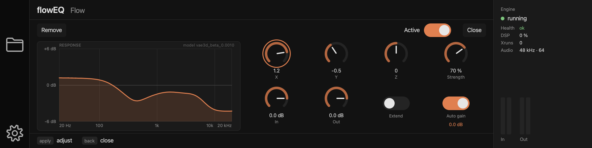

# flowEQ's panel

The node editor for `nc.eq.flow` — flowEQ's lite EQ, which the engine implements
(`../../namchain/docs/floweq.md`). A block of that type does not get the generic list of knobs: it
gets its own layout, `qml/views/FlowEqPanel.qml`, with the response curve the **engine** computed
beside the eight controls the lite plugin has.

## Why a panel of its own

The generic editor (`NodeEditor.qml`, built from `engine.schema`) would already show the right
controls: rotary knobs for X, Y, Z, Strength, In and Out, toggles for Extend and Auto Gain. What it
cannot show is the thing flowEQ is about — what the EQ is *doing* — because that is not in the
document. The three latent values are the input; the five bands and their response are what the
node made of them, and only the engine knows them (it carries the model). namchain publishes them
as `rig.state`, and this panel draws them.

The layout follows the lite plugin: the latent point and Strength next to the curve, the gains and
the two modes below. Reading order is also the ring order, so the hardware rotary visits X, Y, Z,
Strength, In, Out, Extend and Auto Gain in the order the eye does, then Bypass, Close and Remove.

## The controls

| cell | parameter | control | notes |
|---|---|---|---|
| row 1, 1–3 | `x`, `y`, `z` | rotary | −2…2, the plugin's slider range; a double tap resets to 0 |
| row 1, 4 | `strength` | rotary | published as a percentage; 0 is the identity EQ |
| row 2, 1–2 | `in_db`, `out_db` | rotary | −60…+12 dB; Out is not in the path while Auto Gain is on |
| row 2, 3 | `extend` | toggle | doubles the latent values before the decoder |
| row 2, 4 | `auto_gain` | toggle | the compensation the engine measured is shown under it, once it is on |

All eight are the engine's own parameters, so this is the same editing path as everywhere else:
a rampable parameter streams `rig.patch set_param` at most every 10 ms with one patch in flight
(`EditStream`), and the document is read back after the edit. Nothing here keeps its own idea of a
value except while a control is being moved, which is the generic editor's rule too.

`ramp_ms` is the ninth parameter of the node and is deliberately **hidden** from the schema's
inspector list: it is the smoothing time a rig file may tune, not a control the lite plugin has.

## The curve

`FlowEqModel` (`src/rig/FlowEqModel.cpp`) reads `rig.state` while the panel is open and turns the
96 dB values the engine reports into the SVG path a `PathSvg` draws. The maths is in C++, as the
project requires; the QML only positions the `Shape`.

- **The axis** grows with the curve: the smallest multiple of 6 dB that holds it, from ±6 dB to
  ±48 dB. A gentle curve fills the plot rather than hugging a flat line, and a moved knob visibly
  scales the shape. The panel's dB labels are the axis in force.
- **The curve is the audible plan's**, not the document's, so what is drawn is what is heard.
- **The fill** under the line is the same path closed to the bottom of the plot.
- **Model name** (`model vae3d_beta_0.0010`) is in the panel's corner: flowEQ-lite is one decoder,
  and which one is worth knowing when a curve looks unexpected.
- **Auto Gain** shows the compensation the engine is applying (`gainText`), because with it on, Out
  is not in the path and the output level is no longer the knob's.

## Polling, and keeping the screen static

The engine pushes nothing, so the panel asks. It asks once when it opens, then while a control is
moving and for two seconds after the last edit, and then stops: ten reads a second while there is
something to see, none while the screen is idle (docs/spec.md, the D14 constraint). A reply that is
the same as the last one — to a hundredth of a dB — does not redraw. Closing the editor, or opening
a block that is not flowEQ, stops the watch and clears the curve.

A reply that no longer names the node (its chain was swapped, the rig changed) makes the panel say
"waiting for the engine" rather than keep drawing a curve nobody is running.

## What is not here

The full flowEQ plugin's semantic mode, its latent-dimension and β model selectors, manual mode
with per-band controls, and its Auto Gain range and update-rate settings. The engine implements the
lite feature set and so does the panel; anything more starts with a model selector, which is an
engine change first.

The bands' numbers (gain, frequency, Q of each of the five sections) are in the `rig.state` reply
but not on the screen: the curve says more in less space, and the screen is 1920×480 shared with the
rig.
