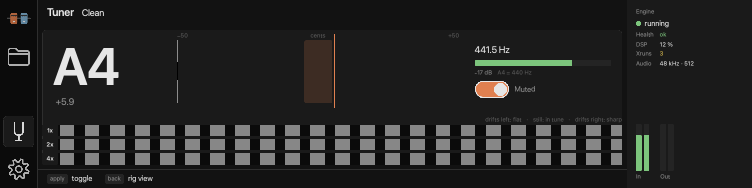
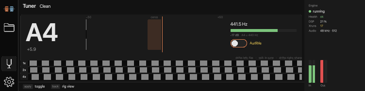

# The tuner in rigpa

The pedal's tuner: a main view of its own, reached from the menu button directly above Settings
(`qml/Menu.qml`). It shows the note, how many cents off it is, the frequency and the input level,
and while it is up **the rig is silent** — the amp behind the tuner hears nothing, so the player
tunes against a still amp rather than a speaker in the room.

The engine half is `nc.tuner` (`../namchain/docs/tuner.md`): squatch-dsp's tuner as a node with one
input, one output and a silent output. This page is the UI's side of it.

## How the view turns into a muted rig

The node is **not** in the rig. It is mounted while the view is up and removed when it goes:

1. The menu button (or `--view tuner`) calls `Navigator::showMainView(TunerView)`.
2. `App` connects `Navigator::mainViewChanged` to two things: `RigSession::setTuner(true)` and
   `TunerModel::setWatching(true)`.
3. `RigSession` publishes the running document **with one `nc.tuner` after each chain's input**
   (`edits::injectTuner`, `src/rig/RigEdits.*`), marked `meta.ephemeral`. That publish is not
   recorded: it is not undoable, it is not drawn on the canvas, and it is not saved.
4. The node's output is silence, so every chain is muted. `TunerModel` polls `rig.state` at 30 Hz
   while the view is up and draws the reading.
5. Back, or another main view, does the same in reverse: `setTuner(false)` publishes the document
   without the node, and the rig is audible again.

Three consequences worth knowing:

- **The node survives the edits you make while the tuner is up.** Any document rigpa publishes while
  the tuner is on carries the node (`RigSession::applyJson` injects on the way out), so an edit made
  with the tuner on screen does not un-mute the rig.
- **The engine's document is stripped before rigpa adopts it.** `rig.get` returns what is running,
  which includes the node; `RigSession::fetchDocument` and `RigManager::saveNow` strip it, so the
  canvas, the undo history and the library never see it. pedald does the same before it writes its
  resume record (`devices/common/rootfs/usr/local/lib/pedald/resume.py`).
- **A rig that arrives from elsewhere gets the node too.** While the view is up, a document adopted
  from the engine (a footswitch through pedald, a `rig.load`) is published again with the node, once
  per generation so a refused mount does not retry for ever. "The tuner is up" means the rig is
  muted, whichever rig it is.

## The switch

The toggle under the numbers opens the node's switch (`mute`, a **rampable flag** in namchain's
schema): the input then passes through unchanged and the display carries on, which is how a player
tunes with the rig audible. It is the view's one stop for the rotary — apply toggles it — so a pedal
with nothing but a knob and a footswitch can still open it.

- The button shows the player's intent (`RigSession::tunerMuted`), not the engine's report: it must
  move when it is pressed. `RigSession::setTunerMuted` sends one `rig.patch` per chain, because a
  patch names the chain it applies to, and a refusal puts the button back and says why.
- The engine answers `smooth`, so the node fades the pass-through over 5 ms and **nothing rebuilds**:
  the reading does not restart and the strobe does not jump. `TunerModel::muted` is what the engine
  reports, which is how a refused patch shows up as a disagreement rather than a lie.
- The choice is kept for the session and **not saved**: a real pedal's switch stays where it was
  pushed, `mute` is the node's default, and so the app always starts with the tuner silent. While
  the switch is open the label reads "Audible" in the warning colour, because a tuner that is not
  muting the rig is the one thing a player can be surprised by.

## The strobe

Three rows, labelled **1x, 2x, 4x**: partials 1, 2 and 4 of the note. Row *k* drifts *k* times as
fast as the fundamental — `0.5 · cents · k` band periods per second, clamped to ±12 so it cannot
alias at 60 fps — so the bottom row shows an error the top one barely shows, and **in tune every row
stands still**, which is the reading a player actually tunes to. Sharp drifts right, flat drifts
left; the legend above the rows says so.

The law is in `TunerModel` (`kDriftPerCent`, `kMaxDrift`), ported from squatch-tuner's reference
implementation (`hosts/web/strobe.js`), and the QML only places bands: 40 fixed bands per row,
translated by the phase and wrapped by the row's clip, so a frame costs one `x` change per row.
`TunerModel::advance` is called by the view's 16 ms timer — the strobe runs at display rate, not at
the reading's 30 Hz — and it is fed the *interval* rather than a tick count, so a dropped frame moves
the bands further instead of slower, and a stalled one (a suspension) is clamped rather than
teleporting a whole period. With no note there is nothing to drift: the rows settle and fade to 22 %,
the reference's own gesture for "the strings have stopped".

The animation is a real cost on the pedal (D14): 60 frames a second while the tuner is up, and
nothing at all when it is not — the timer runs only while the view is the main view.

## What the view says

| | |
|---|---|
| the note | `A4`, big, in `Theme.good` when it is in tune and `Theme.text` when it is not |
| the cents | one decimal, signed; the needle on a ±50-cent scale, the in-tune band ±5 cents |
| the frequency | the engine's `hz`, one decimal |
| the level | the engine's `level_db` as a bar over −60…0 dBFS, so "nothing is plugged in" is visible |
| the strobe | three rows, partials 1, 2 and 4, labelled 1x/2x/4x — see above |
| the switch, and "Muted" / "Audible" | the node's `mute`, in `Theme.warn` when the rig is audible |
| "The rig is not muted — the engine is running no tuner node" | in `Theme.warn`, when a publish was refused or an engine too old for the node is running. This is the honest failure mode: the view is up and the amp is still audible, and the player has to know |

The engine withholds a note it does not trust — a decaying string in the room's hum, partials that
disagree by more than 3 cents — and in that case the state omits the note rather than repeating the
last one, so the view shows "No note" and an em dash. A note held perfectly steady does not repaint
the screen: the model compares what it would draw (needle in pixels, texts, in-tune) and emits only
on a change, so `blocks` moving alone is not a redraw.

## Hardware controls

The view has **one stop**: the switch. Rotate does nothing with one stop (the ring does not wrap),
apply toggles it, and back returns to the rig view — which also unmounts the node. `docs/spec.md`'s
table is the specification and `tests/tst_navigator.cpp` the oracle.

A menu button is the activation until the Pico's controls path exists: the pedal's footswitches reach
rigpa through pedald, and mapping one to the tuner is that work, not this view's.

## The model

`src/rig/TunerModel.*` is the reading and nothing else: `rig.state`, one request in flight, 30 Hz,
started and stopped by the view. It exposes what the view draws — `noteText`, `centsText`, `hzText`,
`levelText`, `inTune`, `needleX` (pixels in a `barWidth`-wide scale), `levelFraction`, `status` —
with the layout maths in C++, as everywhere else. `available`, `running` and `valid` are three
different facts and the view uses each: "the engine has answered", "the engine is running the node"
and "the engine has a note".

## What is not here

- A moving strobe. namchain publishes the reading, not the per-partial phases a strobe animates to;
  a strobe wants a phase rate from the engine or a client integrating cents on its own clock.
- A reference-pitch control (A4 is 440 Hz, the engine's).
- Which engine the tuner works against: any that publishes `nc.tuner` in `engine.schema` and the
  `node_state` feature. `EngineSession::hasTuner()` is that check, and the menu button is disabled
  without it rather than publishing a document the engine would refuse.

## Tests

- `tests/tst_tuner.cpp` — the model, from synthetic `rig.state` replies: which node is ours, a
  withheld note shown as none, the needle's ends, the level's fraction, the switch's two spellings
  (a bool and a flag's 0/1), the drift law (a partial's rate, the clamp, still when in tune, frozen
  with no note and when not watching, and a stalled clock), no redraw when only `blocks` moves, and
  everything forgotten when the view is left.
- `tests/tst_tuner_live.cpp` — against a real `namchaind`: mounting puts one node after each chain's
  input (two chains in the Dual fixture), the state reports it, rigpa's own document never holds it,
  the switch patches every chain and the engine reports it open, and unmounting leaves the document
  as it was.
- `tests/tst_edits.cpp` — `injectTuner`/`stripTuner` on documents: every chain, a bare-graph
  document, a non-editable chain's splice, id collisions, a hand-written tuner node left alone, and
  `strip(inject(d)) == d` byte for byte.
- `tests/tst_navigator.cpp` — the tuner row of the hardware table.
